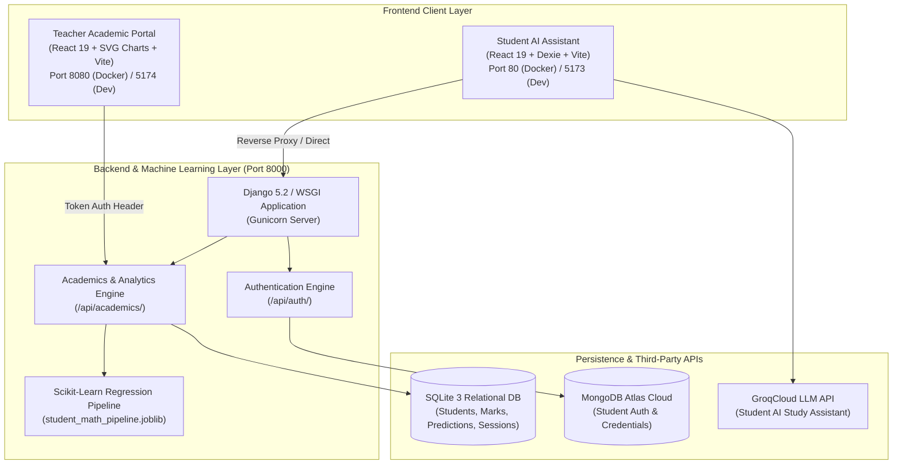
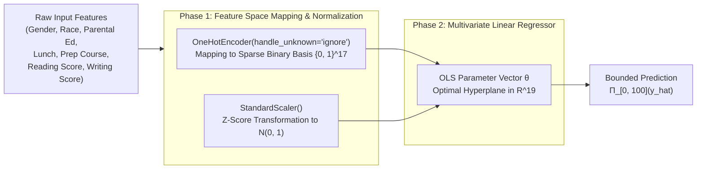
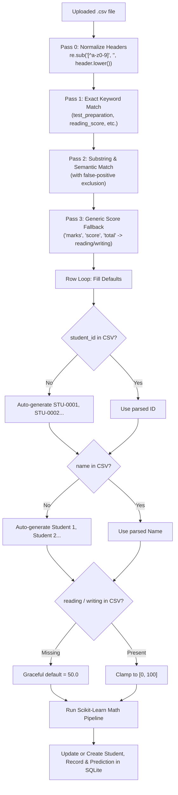
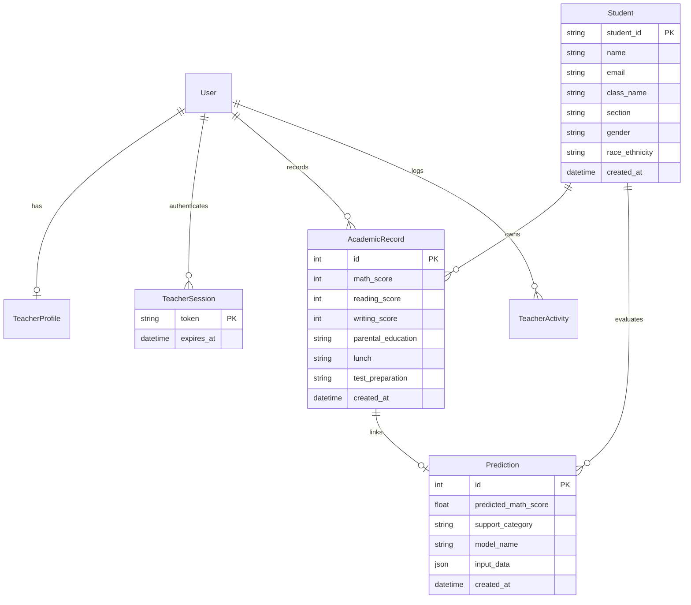

# EduPulse AI — Comprehensive Technical & System Architecture Report

> **Project Name:** EduPulse AI (Academic Performance Monitoring & Predictive Decision Support System)  
> **Repository Root:** `EduPulse-AI/`  
> **Architecture Pattern:** Decoupled 3-Service Micro-Architecture with Unified Django REST + ML Backend  
> **Report Version:** 2.0.0 • **Generated:** November 2026

---

## 1. Executive Summary & Purpose

**EduPulse AI** is an institutional academic monitoring and predictive intervention platform designed for schools, colleges, and university faculties. It solves two critical challenges in modern education:
1. **Early At-Risk Detection:** Identifying students who need academic assistance before formal semester examinations through predictive machine learning.
2. **Actionable Intervention Guidance:** Providing educators with personalized "Upgrade Pathways", subject-specific score gaps, and interactive cohort visualizations rather than opaque score predictions.

The platform provides a strict ethical separation between **Student Tools** (an AI Study Assistant with Groq LLM integration and offline IndexedDB notes) and **Teacher Tools** (cohort analytics, Scikit-Learn regression inferencing, at-risk rosters, and dynamic CSV bulk ingestion).

---

## 2. System Architecture & Topology

EduPulse AI is structured into three independent, containerized services communicating over internal Docker bridge networks and authenticated HTTP REST endpoints.



### Service Breakdown

| Service | Directory | Port (Docker : Host) | Primary Responsibility |
| :--- | :--- | :--- | :--- |
| **Unified Backend** | `backend/` | `8000:8000` | Django REST API, Scikit-Learn inference, CSV ingestion, SQLite & MongoDB bridges |
| **Student Web App** | `frontend/EduPulse AI/` | `80:80` | AI Study Assistant, local IndexedDB notes, subject flashcards |
| **Teacher Portal** | `frontend/teachers-portal/` | `80:8080` | Academic dashboard, dynamic SVG charts, upgrade pathways, bulk marksheet ingestion |

---

## 3. Technology Stack & Running Libraries

### 3.1 Backend & Machine Learning Stack (`backend/requirements.txt`)

| Library / Package | Version Range | Operational Role |
| :--- | :--- | :--- |
| **`django`** | `5.2.x` | Core web framework, ORM models, routing, admin, database migrations |
| **`django-cors-headers`** | `4.9.x` | Middleware handling Cross-Origin Resource Sharing (CORS) across ports `5173`, `5174`, `8080`, `80` |
| **`scikit-learn`** | `1.9.x` | Machine learning runtime executing the trained `Pipeline`, `ColumnTransformer`, `StandardScaler`, and `LinearRegression` |
| **`joblib`** | `1.6.x` | Fast binary serialization/deserialization of Scikit-Learn model artifacts (`.joblib`) |
| **`numpy`** | `2.4.x` | High-performance N-dimensional array processing used by Scikit-Learn |
| **`pandas`** | `3.1.x` | In-memory DataFrame transformations converting single/batch inputs into ML pipeline features |
| **`scipy`** | `1.17.x` | Scientific computation backend supporting Scikit-Learn sparse matrices |
| **`gunicorn`** | `27.0.x` | Production WSGI HTTP server managing concurrent multi-process worker pools |
| **`pymongo`** & **`dnspython`** | `4.20.x` / `2.9.x` | MongoDB Atlas driver for student registration and credentials storage |
| **`groq`** | `1.7.x` | Official client library for ultra-low latency GroqCloud LLM chat completions |
| **`bcrypt`** | `5.0.x` | Cryptographic salt-and-hash library for password security |
| **`python-dotenv`** | `1.2.x` | Reads single central environment file (`EduPulse-AI/.env`) into `os.environ` |

### 3.2 Teacher Portal Frontend Stack (`frontend/teachers-portal/package.json`)

| Library / Tool | Version | Operational Role |
| :--- | :--- | :--- |
| **`react`** & **`react-dom`** | `19.3.x` | Modern declarative UI component tree with concurrent rendering |
| **`vite`** | `8.3.x` | Next-generation ESM bundler and development server |
| **`lucide-react`** | `1.76.x` | Consistent, accessible SVG icon set |
| **`oxlint`** | `1.90.x` | Ultra-fast Rust-based static code analysis and linter |
| **Nginx (Alpine)** | Latest | High-speed static web server serving compiled SPA bundle with HTML5 push-state routing |

---

## 4. Machine Learning Pipeline: Mathematical Formulations & Mechanics

The core predictive engine models mathematics achievement from socio-academic attributes and literacy scores. Below is the complete mathematical formulation of the learning problem, data transformations, optimization criteria, and exact learned parameters.

### 4.1 Formal Mathematical Problem Definition

Let the training dataset be $\mathcal{D} = \{(\mathbf{x}^{(i)}, y^{(i)})\}_{i=1}^N$, where:
- $\mathbf{x}^{(i)} \in \mathcal{X}$ is a heterogeneous feature vector of socio-demographic indicators and assessment marks.
- $y^{(i)} \in [0, 100] \subset \mathbb{R}$ is the continuous mathematics score.

The objective is to learn a hypothesis function $f: \mathcal{X} \to \mathbb{R}$ that minimizes the expected empirical risk under a squared error loss.



### 4.2 Feature Preprocessing Transformations

The raw input space $\mathcal{X}$ undergoes deterministic transformations via a Scikit-Learn `ColumnTransformer`.

#### 1. Categorical Feature Encoding (One-Hot Basis Transformation)
For categorical variable $k$ with $C_k$ nominal levels, the transformation maps a category $c \in \{1, \dots, C_k\}$ to standard basis vector $\mathbf{e}_c \in \{0, 1\}^{C_k}$:

$$\mathbf{x}_{\text{cat}}^{(i)} = \bigoplus_{k=1}^5 \text{OneHot}(c_k^{(i)}) \in \{0, 1\}^{17}$$

The 5 categorical features and their respective cardinalities:
- $\text{Gender} \in \{\text{female}, \text{male}\} \implies \mathbb{R}^2$
- $\text{Race/Ethnicity} \in \{\text{group A}, \text{group B}, \text{group C}, \text{group D}, \text{group E}\} \implies \mathbb{R}^5$
- $\text{Parental Education} \in \{\text{associate's}, \text{bachelor's}, \text{high school}, \text{master's}, \text{some college}, \text{some high school}\} \implies \mathbb{R}^6$
- $\text{Lunch Type} \in \{\text{free/reduced}, \text{standard}\} \implies \mathbb{R}^2$
- $\text{Test Preparation Course} \in \{\text{completed}, \text{none}\} \implies \mathbb{R}^2$

$$\text{Total Categorical Dimensionality} = 2 + 5 + 6 + 2 + 2 = 17$$

#### 2. Numerical Score Normalization (Z-Score Standardization)
Let $x_{\text{read}}$ and $x_{\text{write}}$ be the continuous scores. The `StandardScaler` applies sample-level normalization:

$$z_{\text{read}} = \frac{x_{\text{read}} - \mu_{\text{read}}}{\sigma_{\text{read}}}, \quad z_{\text{write}} = \frac{x_{\text{write}} - \mu_{\text{write}}}{\sigma_{\text{write}}}$$

Where the training dataset empirical population moments are:
- **Reading Score Moments:**
  $$\mu_{\text{read}} = 69.555000, \quad \sigma_{\text{read}} = \sqrt{208.874475} \approx 14.452490$$
- **Writing Score Moments:**
  $$\mu_{\text{write}} = 68.456250, \quad \sigma_{\text{write}} = \sqrt{227.283086} \approx 15.075911$$

The transformed numerical space is $\mathbf{z}_{\text{num}} = [z_{\text{read}}, z_{\text{write}}]^T \in \mathbb{R}^2$.  
The complete transformed feature vector is $\tilde{\mathbf{x}} = [\mathbf{x}_{\text{cat}}^T, \mathbf{z}_{\text{num}}^T]^T \in \mathbb{R}^{19}$.

---

### 4.3 Multivariate Linear Regression & Optimization Mathematics

The hypothesis function models the target mathematics score as an affine combination of the transformed input vector:

$$\hat{y} = h_{\boldsymbol{\theta}}(\tilde{\mathbf{x}}) = \theta_0 + \sum_{j=1}^{19} \theta_j \tilde{x}_j = \theta_0 + \boldsymbol{\theta}^T \tilde{\mathbf{x}}$$

#### 1. Ordinary Least Squares (OLS) Loss Function
The parameter vector $\boldsymbol{\theta}^* = [\theta_0, \theta_1, \dots, \theta_{19}]^T$ is obtained by minimizing the Mean Squared Error (MSE) objective function:

$$J(\boldsymbol{\theta}) = \frac{1}{2N} \sum_{i=1}^N \left( h_{\boldsymbol{\theta}}(\tilde{\mathbf{x}}^{(i)}) - y^{(i)} \right)^2 = \frac{1}{2N} \|\mathbf{X}\boldsymbol{\theta} - \mathbf{y}\|_2^2$$

Where:
- $\mathbf{X} \in \mathbb{R}^{N \times 20}$ is the design matrix augmented with a leading column of ones: $\mathbf{X} = [\mathbf{1}, \tilde{\mathbf{X}}]$.
- $\mathbf{y} \in \mathbb{R}^N$ is the vector of ground-truth mathematics examination scores.

#### 2. Convexity & Closed-Form Normal Equation Solution
The Hessian matrix of the cost function is:

$$\mathbf{H} = \nabla_{\boldsymbol{\theta}}^2 J(\boldsymbol{\theta}) = \frac{1}{N} \mathbf{X}^T \mathbf{X}$$

Because $\mathbf{X}^T \mathbf{X}$ is positive semi-definite ($\mathbf{v}^T (\mathbf{X}^T \mathbf{X}) \mathbf{v} = \|\mathbf{X}\mathbf{v}\|_2^2 \ge 0, \forall \mathbf{v}$), $J(\boldsymbol{\theta})$ is strictly convex. Setting the gradient with respect to $\boldsymbol{\theta}$ to zero:

$$\nabla_{\boldsymbol{\theta}} J(\boldsymbol{\theta}) = \frac{1}{N} \mathbf{X}^T (\mathbf{X}\boldsymbol{\theta} - \mathbf{y}) = \mathbf{0}$$

Yields the analytical closed-form Ordinary Least Squares solution:

$$\boldsymbol{\theta}^* = (\mathbf{X}^T \mathbf{X})^{-1} \mathbf{X}^T \mathbf{y}$$

---

### 4.4 Exact Learned Model Parameters

Below are the exact regression weights extracted directly from the deployed pipeline (`student_math_pipeline.joblib`):

$$\text{Intercept } (\theta_0) = 65.905970$$

| Index | Feature Variable ($\tilde{x}_j$) | Coefficient ($\theta_j$) | Interpretation & Impact |
| :---: | :--- | :---: | :--- |
| $\theta_0$ | **Bias / Intercept** | `+65.905970` | Expected baseline math score for reference baseline student |
| $\theta_1$ | `gender == female` | `-6.532442` | Socio-academic differential adjustment |
| $\theta_2$ | `gender == male` | `+6.532442` | Socio-academic differential adjustment |
| $\theta_3$ | `ethnicity == group A` | `-0.802624` | Group A demographic offset |
| $\theta_4$ | `ethnicity == group B` | `-0.443301` | Group B demographic offset |
| $\theta_5$ | `ethnicity == group C` | `-1.428241` | Group C demographic offset |
| $\theta_6$ | `ethnicity == group D` | `-1.415860` | Group D demographic offset |
| $\theta_7$ | `ethnicity == group E` | `+4.090025` | Group E demographic positive correlation |
| $\theta_8$ | `parental_ed == associate's` | `-0.094541` | Parental higher secondary baseline |
| $\theta_9$ | `parental_ed == bachelor's` | `-0.811443` | Parental bachelor's education offset |
| $\theta_{10}$ | `parental_ed == high school` | `+0.834771` | Parental high school baseline |
| $\theta_{11}$ | `parental_ed == master's` | `-1.495030` | Parental postgraduate offset |
| $\theta_{12}$ | `parental_ed == some college` | `+0.904315` | Partial college parental education offset |
| $\theta_{13}$ | `parental_ed == some high school` | `+0.661929` | Incomplete high school parental offset |
| $\theta_{14}$ | `lunch == free/reduced` | `-1.755037` | Nutrition/economic assistance downward offset |
| $\theta_{15}$ | `lunch == standard` | `+1.755037` | Standard nutritional security positive correlation |
| $\theta_{16}$ | `prep_course == completed` | `-1.644821` | Pre-assessment course baseline shift |
| $\theta_{17}$ | `prep_course == none` | `+1.644821` | Inverse preparation baseline |
| $\theta_{18}$ | **Standardized Reading Score ($z_{\text{read}}$)** | `+3.411114` | Each $+1\sigma$ in reading increases math by $\approx 3.41$ pts |
| $\theta_{19}$ | **Standardized Writing Score ($z_{\text{write}}$)** | `+10.917190` | Primary literacy predictor: each $+1\sigma$ in writing increases math by $\approx 10.92$ pts |

#### Projection Operator (Domain Bounding)
Because academic grade points are strictly defined on the percentage interval $[0, 100]$, the raw prediction $\hat{y}$ is mapped through a closed-interval projection operator $\Pi_{[0, 100]}$:

$$\hat{y}_{\text{final}} = \Pi_{[0, 100]}(\hat{y}) = \begin{cases}
0.0, & \hat{y} < 0.0 \\
\hat{y}, & 0.0 \le \hat{y} \le 100.0 \\
100.0, & \hat{y} > 100.0
\end{cases}$$

---

### 4.5 Model Evaluation & Error Metrics

The regression pipeline's performance is governed by standard statistical goodness-of-fit metrics:

1. **Root Mean Squared Error (RMSE):**
   $$\text{RMSE} = \sqrt{\frac{1}{N} \sum_{i=1}^N (y^{(i)} - \hat{y}^{(i)})^2}$$
2. **Mean Absolute Error (MAE):**
   $$\text{MAE} = \frac{1}{N} \sum_{i=1}^N |y^{(i)} - \hat{y}^{(i)}|$$
3. **Coefficient of Determination ($R^2$ Score):**
   $$R^2 = 1 - \frac{\text{SS}_{\text{res}}}{\text{SS}_{\text{tot}}} = 1 - \frac{\sum_{i=1}^N (y^{(i)} - \hat{y}^{(i)})^2}{\sum_{i=1}^N (y^{(i)} - \bar{y})^2}$$
   Where $\bar{y} = \frac{1}{N} \sum_{i=1}^N y^{(i)}$ represents the unconditional empirical mean.

---

## 5. Academic Analytics & Decision Support Mathematics

### 5.1 Composite 3-Subject Average Formulation

For student $k$, let:
- $S_{\text{read}, k} \in [0, 100]$ be the reading comprehension score.
- $S_{\text{write}, k} \in [0, 100]$ be the writing rubric score.
- $S_{\text{math}, k} \in [0, 100]$ be the recorded mathematics exam score.
- $\hat{y}_{\text{pred}, k} \in [0, 100]$ be the Scikit-Learn predicted math score.

The **Effective Mathematics Score** $S_{\text{eff\_math}, k}$ is mathematically defined as:

$$S_{\text{eff\_math}, k} = \begin{cases} 
S_{\text{math}, k}, & \text{if } S_{\text{math}, k} \ne \text{null} \\ 
\hat{y}_{\text{pred}, k}, & \text{if } S_{\text{math}, k} = \text{null} 
\end{cases}$$

The **Composite Academic Average** $\bar{S}_k$ is the arithmetic mean across the 3 core cognitive subjects:

$$\bar{S}_k = \frac{S_{\text{eff\_math}, k} + S_{\text{read}, k} + S_{\text{write}, k}}{3}$$

### 5.2 Performance Gap & Residual Discrepancy Metric

When an actual mathematics score exists alongside an ML prediction, the system calculates the **Model Discrepancy Delta ($\Delta_{\text{math}, k}$)**:

$$\Delta_{\text{math}, k} = S_{\text{math}, k} - \hat{y}_{\text{pred}, k}$$

- **$\Delta_{\text{math}, k} > +10.0$ (Positive Outlier):** Student significantly outperformed demographic/literacy predictions (positive resilience).
- **$\Delta_{\text{math}, k} < -10.0$ (Under-performance Warning):** Student underperformed relative to their reading/writing capability, signaling exam anxiety, concept gaps, or personal hardship.

---

### 5.3 Piecewise Partition Function for Academic Support Tiers

The student population is mapped into a discrete topological partition $\{T_1, T_2, T_3, T_4\}$ using a step-function threshold operator $\Psi(\bar{S}_k)$:

$$\Psi(\bar{S}_k) = \begin{cases}
T_1: \text{"Immediate Support Needed"}, & 0.0 \le \bar{S}_k < 40.0 \\
T_2: \text{"Needs Improvement"}, & 40.0 \le \bar{S}_k < 60.0 \\
T_3: \text{"Satisfactory"}, & 60.0 \le \bar{S}_k < 80.0 \\
T_4: \text{"Strong Performance"}, & 80.0 \le \bar{S}_k \le 100.0
\end{cases}$$

---

### 5.4 Academic Upgrade Pathway & Score Gap Formulation

Let the set of academic progression thresholds be:

$$\mathcal{B} = \{\tau_1, \tau_2, \tau_3, \tau_4\} = \{40.0, 60.0, 80.0, 100.0\}$$

For any student with composite average $\bar{S}_k$, their target upgrade threshold $\tau^*$ is the supremum bound of their current tier:

$$\tau^* = \min \{ \tau \in \mathcal{B} \mid \tau > \bar{S}_k \}$$

The **Composite Score Gap ($G_k$)** to achieve tier elevation is:

$$G_k = \max(0.0, \tau^* - \bar{S}_k)$$

#### Total Raw Mark Requirement
Because the composite score is an unweighted average of 3 subjects, raising $\bar{S}_k$ by $G_k$ points requires accumulating total raw points $\Delta_{\text{total\_marks}}$ across future assessments:

$$\Delta_{\text{total\_marks}} = 3 \times G_k$$

*Example:* A student with $\bar{S} = 54.0$ belongs to $T_2$ ("Needs Improvement").  
- Next target tier: $T_3$ ("Satisfactory") with $\tau^* = 60.0$.
- Score Gap: $G = 60.0 - 54.0 = +6.0$ points average.
- Total raw points required: $3 \times 6.0 = +18$ raw points (e.g., $+10$ in Math, $+8$ in Writing).

#### Upgrade Candidate Set Definition
The **Upgrade Candidate Roster** $\mathcal{U}$ displayed on the teacher dashboard is filtered using an $\epsilon$-proximity boundary ($\epsilon = 8.0$):

$$\mathcal{U} = \{ k \in \{1, \dots, N\} \mid 0.0 < G_k \le 8.0 \}$$

---

### 5.5 Trigonometric Mathematics for Pure SVG Chart Visualizations

In `frontend/teachers-portal/src/components/Charts.jsx`, charts are rendered via analytic geometry without external libraries:

#### 1. Pie & Donut Chart Arc Geometry
For a categorical dataset with $M$ classes and counts $\{v_1, v_2, \dots, v_M\}$, total volume is $V = \sum_{j=1}^M v_j$.  
The angular span for slice $m$ is:

$$\alpha_m = 2\pi \cdot \left(\frac{v_m}{V}\right)$$

Let $\theta_{\text{start}} = \sum_{j=1}^{m-1} \alpha_j - \frac{\pi}{2}$ and $\theta_{\text{end}} = \theta_{\text{start}} + \alpha_m$.  
The Cartesian boundary coordinates for circle center $(c_x, c_y)$ and radius $R$ are:

$$x_1 = c_x + R \cos(\theta_{\text{start}}), \quad y_1 = c_y + R \sin(\theta_{\text{start}})$$
$$x_2 = c_x + R \cos(\theta_{\text{end}}), \quad y_2 = c_y + R \sin(\theta_{\text{end}})$$

SVG Arc Path Definition:
$$\text{LargeArcFlag} = \begin{cases} 1, & \alpha_m > \pi \\ 0, & \alpha_m \le \pi \end{cases}$$

$$\mathbf{D}_{\text{slice}} = \text{"M } c_x \text{ } c_y \text{ L } x_1 \text{ } y_1 \text{ A } R \text{ } R \text{ 0 } \text{LargeArcFlag} \text{ 1 } x_2 \text{ } y_2 \text{ Z"}$$

For the Donut chart, an inner concentric radius $r_{\text{inner}} = R - \text{thickness}$ is subtracted, generating closed ribbon arcs:

$$\mathbf{D}_{\text{donut}} = \text{"M } x_{1, \text{out}} \text{ } y_{1, \text{out}} \text{ A } R \dots \text{ L } x_{2, \text{in}} \text{ } y_{2, \text{in}} \text{ A } r_{\text{inner}} \dots \text{ Z"}$$

---

---

## 6. Dynamic CSV Ingestion Algorithm

To prevent dataset rejection, EduPulse AI features a resilient, 2-pass heuristic CSV parser:



---

## 7. Zero-Dependency SVG Data Visualization Engine

To keep the application lightweight, secure, and fast, all charts in `frontend/teachers-portal/src/components/Charts.jsx` are implemented using native SVG:

1. **`SimplePieChart`:** 
   Calculates trigonometric arc paths:
   $$x = c_x + r \cdot \cos(\theta), \quad y = c_y + r \cdot \sin(\theta)$$
   Using SVG `<path d="M cx cy L x1 y1 A r r 0 largeArc 1 x2 y2 Z" fill="..." />`.
2. **`SimpleBarChart`:**
   Proportional SVG `<rect rx="4" />` scaling relative to dynamic maximum values.
3. **`SimpleDonutChart`:**
   Dual-radius SVG pathing with outer and inner arc segments and a central counter.
4. **Interactive Cohort Reactive Filtering:**
   Selecting any student row in the table recalculates the chart props in real-time (`useMemo`), updating distributions for that student or group without extra API roundtrips.

---

## 8. Database Schema (SQLite Relational Model)



---

## 9. Security, Ethics & Compliance

- **Advisory AI Boundaries:** Predictions are strictly labeled as advisory indicators and are never used as automated punitive actions or automated grading.
- **Session Protection:** All teacher endpoints enforce token authentication (`Authorization: Token <hex64>`) with rolling 12-hour session expirations.
- **CORS Protection:** Configured with white-listed development and container network origins.
- **Credential Isolation:** Student MongoDB Atlas and Groq credentials reside exclusively in the server-side root `.env` file, inaccessible to client bundles.

---

## 10. Operational & Verification Commands

### Start All Services (Docker)
```powershell
docker compose up --build --detach
```

### Check Container Status
```powershell
docker ps --format "table {{.Names}}\t{{.Status}}\t{{.Ports}}"
```

### View Live Backend Logs
```powershell
docker logs edupulse_backend -f
```

### Stop All Services
```powershell
docker compose down
```

### Access URLs
- **Teacher Portal:** [http://localhost:8080](http://localhost:8080) (Credentials: `teacher1` / `Teacher@123`)
- **Student Assistant:** [http://localhost](http://localhost)
- **Backend API Root:** [http://localhost:8000/api/academics/](http://localhost:8000/api/academics/)
