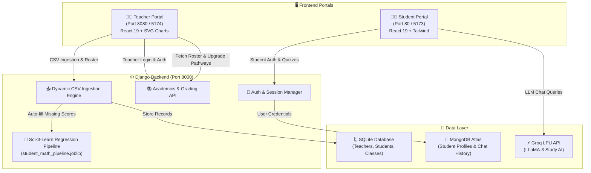

# 🎓 EduPulse AI — Smart Study Assistant & Performance Analytics

<p align="center">
  
  
  
  
  
  
  
  
</p>

A full-stack Generative AI study portal and predictive analytics platform built with **React (Vite)**, **Django**, **MongoDB Atlas**, and **Groq LPU API**, paired with an intelligent **Scikit-Learn** student performance pipeline, dynamic CSV ingestion engine, and a dual-portal architecture for both students and teachers.

---

## 📑 Table of Contents

- [🌟 System Highlights & Key Features](#-system-highlights--key-features)
- [🏛️ System Architecture](#️-system-architecture)
- [🌐 Quick Service Matrix & Default Credentials](#-quick-service-matrix--default-credentials)
- [🚀 Step-by-Step Execution Guide](#-step-by-step-execution-guide)
  - [Option A: One-Click Docker Setup (Recommended)](#option-a-one-click-docker-setup-recommended)
  - [Option B: Manual Local Setup (Development Mode)](#option-b-manual-local-setup-development-mode)
  - [📖 Dedicated First-Time Laptop Setup Guide (FIRST_TIME_SETUP.md)](#-additional-documentation)
- [📊 Dynamic CSV Ingestion & Upgrade Engine](#-dynamic-csv-ingestion--upgrade-engine)
- [📡 API Endpoints Directory](#-api-endpoints-directory)
- [📂 Current Repository Structure](#-current-repository-structure)
- [💻 Original Setup Guide: Running EduPulse AI on Another Laptop](#running-edupulse-ai-on-another-laptop)
- [🛠️ Key Modifications Made](#key-modifications-made-)
- [📚 Additional Documentation](#-additional-documentation)

---

## 🌟 System Highlights & Key Features

### 🧑‍🎓 Student Portal (`frontend/EduPulse AI`)
* **🤖 Groq LPU Generative AI Chat**: Instant academic Q&A, study plans, and topic explanations powered by LLaMA-3 through Groq's high-speed inference.
* **📝 Interactive Adaptive Quizzes**: Generates dynamic quizzes based on custom subjects and difficulty tiers with real-time feedback.
* **📈 Personal Performance Analytics**: Tracks student progression, subject masteries, and historical test trends.

### 👩‍🏫 Teacher Portal (`frontend/teachers-portal`)
* **📂 Dynamic CSV Ingestion Engine**: Upload student grade records in **ANY** CSV schema without rigid column naming requirements. Automatically infers aliases, assigns IDs, clamps values, and predicts missing scores.
* **🧠 Multi-Student Dynamic Analytics**: Interactive pure SVG charts (Donut, Bar, Pie) that recalculate on-the-fly when teachers select individual students or entire cohorts.
* **🎯 Four-Tier Support Classification**:
  * 🔴 **High Support** ($Score < 50$): Targeted remediation & prerequisite review.
  * 🟡 **Moderate Support** ($50 \le Score < 70$): Weekly problem sets & concept reinforcement.
  * 🟢 **Low Support** ($70 \le Score < 85$): Advanced problem solving & peer tutoring.
  * ⭐ **Enrichment** ($Score \ge 85$): Olympiad prep, capstone projects & honors tracks.
* **🚀 Actionable Upgrade Pathways**: Provides students and teachers with the target score, exact score gap, and structured pedagogical interventions needed to reach the next tier.

---

## 🏛️ System Architecture



---

## 🌐 Quick Service Matrix & Default Credentials

| Service | Environment | URL | Port | Default Credentials |
| :--- | :--- | :--- | :--- | :--- |
| **👩‍🏫 Teacher Portal** | Docker | [http://localhost:8080](http://localhost:8080) | `8080` | `teacher1` / `Teacher@123` |
| **👩‍🏫 Teacher Portal** | Local Dev | [http://localhost:5174](http://localhost:5174) | `5174` | `teacher1` / `Teacher@123` |
| **🧑‍🎓 Student Portal** | Docker | [http://localhost:80](http://localhost:80) | `80` | Register / Guest Account |
| **🧑‍🎓 Student Portal** | Local Dev | [http://localhost:5173](http://localhost:5173) | `5173` | Register / Guest Account |
| **⚙️ Django Backend API** | Docker & Dev | [http://localhost:8000](http://localhost:8000) | `8000` | Superuser / Admin |
| **🧭 API Academics Root** | Docker & Dev | [http://localhost:8000/api/academics/](http://localhost:8000/api/academics/) | `8000` | Public / Token |
| **🛡️ Django Admin** | Docker & Dev | [http://localhost:8000/admin/](http://localhost:8000/admin/) | `8000` | Django Superuser |

---

## 🚀 Step-by-Step Execution Guide

### Option A: One-Click Docker Setup (Recommended)

Docker Compose containerizes the entire multi-service stack with a single command. It automatically runs database migrations, collects static assets, and pre-seeds the default teacher account.

#### Prerequisites
- Install and launch [Docker Desktop](https://www.docker.com/products/docker-desktop/) on Windows/Mac/Linux.

#### Execution Steps

1. **Clone the Repository and Navigate to Folder**:
   ```bash
   git clone https://github.com/Hritick-Ghosal/EduPulse-AI.git
   cd EduPulse-AI
   ```

2. **Launch with One-Click Scripts**:
   * **Windows (Command Prompt / Double Click)**:
     ```cmd
     run_docker.bat
     ```
   * **Windows (PowerShell)**:
     ```powershell
     .\run_docker.ps1
     ```
   * **Linux / macOS / Native Docker CLI**:
     ```bash
     docker compose up --build -d
     ```

3. **Verify Containers are Running**:
   ```bash
   docker compose ps
   ```
   You should see `edupulse-backend`, `edupulse-student-app`, and `edupulse-teacher-portal` in the `Up` state.

4. **Access the Web Applications**:
   * Open the **Teacher Portal** at [http://localhost:8080](http://localhost:8080) and log in with:
     * **Username**: `teacher1`
     * **Password**: `Teacher@123`
   * Open the **Student Portal** at [http://localhost:80](http://localhost:80).
   * Backend REST API is live at [http://localhost:8000/api/academics/](http://localhost:8000/api/academics/).

5. **Stopping the Containers**:
   * Double-click `stop_docker.bat` or run:
     ```bash
     docker compose down
     ```

---

### Option B: Manual Local Setup (Development Mode)

Follow these steps if you want to run the services natively for debugging and active development.

#### Prerequisites
- **Python 3.10+**
- **Node.js 18+ & npm**
- **Git**

---

#### 1️⃣ Backend Setup (Django & Scikit-Learn)

1. Open a terminal and navigate to the project directory:
   ```bash
   cd EduPulse-AI
   ```

2. Create and activate a Python virtual environment:
   * **Windows PowerShell**:
     ```powershell
     python -m venv .venv
     .\.venv\Scripts\Activate.ps1
     ```
   * **Linux / macOS**:
     ```bash
     python3 -m venv .venv
     source .venv/bin/activate
     ```

3. Install required Python packages:
   ```bash
   pip install -r backend/requirements.txt certifi
   ```

4. Configure environment variables in `backend/.env`:
   ```ini
   MONGO_DB_USER=<your_mongo_user>
   MONGO_DB_PASSWORD=<your_mongo_password>
   MONGO_DB_CLUSTER=<your_mongo_cluster>
   MONGO_DB_NAME=edupulse_db
   GROQ_API_KEY=<your_groq_api_key>
   CORS_ALLOWED_ORIGINS=http://localhost:5173,http://127.0.0.1:5173,http://localhost:5174,http://127.0.0.1:5174,http://localhost:8080,http://127.0.0.1:8080,http://localhost:80
   ```

5. Run database migrations and seed the teacher account:
   ```bash
   cd backend
   python manage.py migrate
   python manage.py seed_teacher
   ```
   > [!NOTE]
   > `python manage.py seed_teacher` creates or updates default account: **Username**: `teacher1` | **Password**: `Teacher@123`.

6. Start the Django API server:
   ```bash
   python manage.py runserver 0.0.0.0:8000
   ```
   *API root is now running at `http://localhost:8000/api/academics/`.*

---

#### 2️⃣ Student Portal Setup (`frontend/EduPulse AI`)

1. Open a **new terminal** and navigate to the student portal directory:
   ```bash
   cd "EduPulse-AI/frontend/EduPulse AI"
   ```

2. Install frontend dependencies:
   ```bash
   npm install
   ```

3. Launch the Vite development server:
   ```bash
   npm run dev -- --port 5173
   ```
   *Access the Student Portal at `http://localhost:5173`.*

---

#### 3️⃣ Teacher Portal Setup (`frontend/teachers-portal`)

1. Open a **third terminal** and navigate to the teachers portal directory:
   ```bash
   cd "EduPulse-AI/frontend/teachers-portal"
   ```

2. Install dependencies:
   ```bash
   npm install
   ```

3. Launch the Vite development server:
   ```bash
   npm run dev -- --port 5174
   ```
   *Access the Teacher Portal at `http://localhost:5174` and login with `teacher1` / `Teacher@123`.*

---

## 📊 Dynamic CSV Ingestion & Upgrade Engine

The Teacher Portal includes an ultra-flexible CSV ingestion engine:

### 1. Robust Header Normalization
The parser accepts CSV files with arbitrary or missing headers. It automatically maps aliases:
* **Student Identifier**: `student_id`, `id`, `roll`, `reg_no`, `roll_number`
* **Student Name**: `name`, `student_name`, `full_name` (or defaults to `Student STU-XXXX`)
* **Class / Cohort**: `class_name`, `class`, `grade`, `standard`, `section` (or defaults to `Class 10-A`)
* **Scores**: Automatically extracts `math_score`, `reading_score`, `writing_score` or calculates overall academic averages.

### 2. Machine Learning Predictive Fallback
If math scores are missing in the uploaded CSV, the backend automatically invokes the serialized Scikit-Learn model (`backend/ml_models/student_math_pipeline.joblib`) to infer expected math competency based on reading and writing metrics:
$$\hat{y}_{\text{math}} = w_1 \cdot \text{reading\_score} + w_2 \cdot \text{writing\_score} + b$$

### 3. Student Tier Upgrade Pathway
The dashboard automatically computes upgrade gaps for each student:
* **Target Score**: The threshold required to step into the immediate next tier.
* **Score Gap**: $\Delta = \text{Target Score} - \text{Current Score}$.
* **Actionable Interventions**: Custom pedagogical suggestions (remedial sessions, targeted problem sets, peer-led mentorship).

---

## 📡 API Endpoints Directory

| Method | Endpoint | Description | Auth Required |
| :--- | :--- | :--- | :--- |
| `GET` | `/api/academics/` | API directory and service health status | No |
| `POST` | `/api/academics/teacher/login/` | Teacher session authentication | No |
| `POST` | `/api/academics/teacher/logout/` | Teacher session termination | Yes |
| `GET` | `/api/academics/students/` | List all students with support tiers | Yes |
| `POST` | `/api/academics/students/` | Create a new student record manually | Yes |
| `GET` | `/api/academics/students/<id>/` | Detailed student metrics and upgrade path | Yes |
| `POST` | `/api/academics/upload-csv/` | Dynamic CSV file upload & parsing | Yes |
| `GET` | `/api/academics/analytics/` | Full class analytics, tier counts, rosters | Yes |
| `POST` | `/api/academics/predict/` | Scikit-Learn math score prediction | Yes |
| `POST` | `/api/auth/chat/` | Groq LPU Generative AI study assistant | Student |
| `POST` | `/api/auth/generate-quiz/`| Groq LPU dynamic quiz generation | Student |

---

## 📂 Current Repository Structure

```text
EduPulse-AI/
├── .env.example                                # Master environment variables template
├── docker-compose.yml                          # Multi-service production Docker orchestration
├── run_docker.bat                              # Windows batch one-click Docker launcher
├── run_docker.ps1                              # Windows PowerShell one-click Docker launcher
├── stop_docker.bat                             # One-click Docker teardown script
├── ProjectStructure.txt                        # Exhaustive project file-by-file directory
├── PROJECT_REPORT.md                           # Mathematical derivations, ML formulas & technical report
├── CHAT_HISTORY.md                             # Complete chronological interaction history
├── README.md                                   # Comprehensive colorful documentation
│
├── backend/                                    # Django 5.1 API Backend
│   ├── manage.py                               # Django management script
│   ├── requirements.txt                        # Backend dependencies
│   ├── Dockerfile                              # Backend container image definition
│   ├── entrypoint.sh                           # Container startup script (migrations, seed)
│   ├── academics/                              # Academic grading, CSV parser, analytics
│   │   ├── models.py                           # Student, SubjectScore, AcademicRecord
│   │   ├── views.py                            # Dynamic CSV parser, upgrade tier algorithms
│   │   ├── urls.py                             # /api/academics/ endpoints
│   │   └── management/commands/seed_teacher.py # Automatic teacher account seeder
│   ├── authentication/                         # Student auth, MongoDB Atlas, Groq API
│   │   ├── db_config.py                        # MongoDB Atlas connection with SSL certifi
│   │   └── views.py                            # Chatbot and quiz generator endpoints
│   ├── core_backend/                           # Core Django settings, CORS, root URLs
│   └── ml_models/                              # Serialized Scikit-Learn pipeline
│       └── student_math_pipeline.joblib        # Trained math score predictor
│
├── frontend/                                   # Frontend Applications Root
│   ├── EduPulse AI/                            # 🧑‍🎓 Student Portal (Vite + React 19)
│   │   ├── package.json                        # Dependencies (Lucide-React, Tailwind)
│   │   ├── vite.config.js                      # Vite configuration
│   │   ├── Dockerfile                          # Multi-stage production Nginx container
│   │   └── src/                                # React UI, QuizPanel, AnalyticsPanel, Chat
│   │
│   └── teachers-portal/                        # 👩‍🏫 Teacher Portal (Vite + React 19)
│       ├── package.json                        # Teacher portal dependencies
│       ├── vite.config.js                      # Vite configuration (port 5174 / 8080)
│       ├── Dockerfile                          # Multi-stage production Nginx container
│       └── src/
│           ├── components/Charts.jsx           # Zero-dependency dynamic SVG charts
│           ├── pages/DashboardPage.jsx         # Multi-student analytics & upgrade pathways
│           ├── pages/StudentsPage.jsx          # Complete interactive student roster
│           └── pages/CsvUploadPage.jsx         # Dynamic CSV dropzone & upload status
│
├── data/
│   └── StudentsPerformance.csv                 # 1,000-record student benchmark dataset
│
└── notebooks/
    ├── 01_eda.ipynb                            # Exploratory Data Analysis & visual correlation
    └── 02_modeling.ipynb                       # Linear Regression, Random Forest & evaluation
```

---

## Running EduPulse AI on Another Laptop

1. Clone the Repository
PowerShell
```powershell
git clone https://github.com/Hritick-Ghosal/EduPulse-AI.git
cd EduPulse-AI
```

2. Install Backend Dependencies
PowerShell
```powershell
python -m venv .venv
.\.venv\Scripts\Activate.ps1
pip install -r backend\requirements.txt certifi
```

3. Add Environment Secrets (backend/.env)
Create `backend/.env` and paste your credentials:

Code snippet
```ini
MONGO_DB_USER=<your_mongo_user>
MONGO_DB_PASSWORD=<your_mongo_password>
MONGO_DB_CLUSTER=<your_mongo_cluster>
MONGO_DB_NAME=edupulse_db
GROQ_API_KEY=<your_groq_api_key>
CORS_ALLOWED_ORIGINS=http://localhost:5173,http://127.0.0.1:5173
```

4. Install Frontend Dependencies
PowerShell
```powershell
cd "frontend/EduPulse AI"
npm install
```

5. Run Both Servers
Terminal 1 (Backend):

PowerShell
```powershell
cd backend
..\.venv\Scripts\python.exe manage.py runserver
```

Terminal 2 (Frontend):

PowerShell
```powershell
cd "frontend/EduPulse AI"
npm run dev
```

---

## KEY MODIFICATIONS MADE :

### 1. Added Dataset, Notebooks & ML Pipeline (New Files)
The base repository only contained a Generative AI web app and had no tabular ML artifacts. You created and added:

* `data/StudentsPerformance.csv`: Added the 1,000-row Kaggle student exam dataset.
* `notebooks/01_eda.ipynb`: Built the Exploratory Data Analysis notebook to analyze score distributions, correlations, and demographic/test-prep factors.
* `notebooks/02_modeling.ipynb`: Built the Machine Learning training and evaluation notebook for predicting student math scores and identifying at-risk students.
* `backend/ml_models/student_math_pipeline.joblib`: Exported the trained Scikit-Learn preprocessing and prediction pipeline.

### 2. Backend Code Modifications (backend/)
* `backend/core_backend/settings.py`: Removed an invalid "true" string from the CORS_ALLOWED_ORIGINS list so Django's system check passes without crashing on startup.
* `backend/authentication/db_config.py`: Updated the MongoDB Atlas connection to load credentials dynamically from .env (pointing to your active cluster instead of the old unreachable one) and added `tlsCAFile=certifi.where()` inside `MongoClient(...)` to fix Windows SSL/TLS handshake errors.

### 3. Frontend API Routing & UI Updates (frontend/EduPulse AI/src/)
Switched Hardcoded Production URLs to Localhost: Replaced [https://edu-p-luse-backend-ai.vercel.app](https://edu-p-luse-backend-ai.vercel.app) with [http://127.0.0.1:8000](http://127.0.0.1:8000) so the React frontend connects to your local Django server instead of the broken deployed backend:
* `src/index.jsx` (Lines 269 & 324): Updated both `/api/auth/chat/` endpoints.
* `src/login.jsx` (Lines 109, 125 & 142): Updated `/api/auth/login/`, `/api/auth/register/`, and `/api/auth/forgot-password/` endpoints.
* `src/QuizPanel.jsx` (Line 38): Updated the `/api/auth/generate-quiz/` endpoint.
* Updated Frontend Views & Styling: Refined `AnalyticsPanel.jsx`, `Sidebar.jsx`, `main.jsx`, and `assets/styles.css` to support local rendering and analytics integration.

### 4. Local Environment & Security Configuration (Untracked / Git-Ignored)
* Created `backend/.env`: Configured your own `MONGO_DB_USER`, `MONGO_DB_PASSWORD`, `MONGO_DB_CLUSTER`, `MONGO_DB_NAME`, `GROQ_API_KEY`, and `CORS_ALLOWED_ORIGINS`.
* Updated `.gitignore`: Added `.env`, `backend/.env`, `.venv/`, `node_modules/`, and `__pycache__/` so secrets and heavy dependencies are excluded when pushing to GitHub.
* Created `README.md`: Documented the project architecture, tech stack, modification log, and local setup instructions.

### 5. Multi-Portal Architecture & Dedicated Teachers Portal (`frontend/teachers-portal/`)
* Built a standalone, responsive Teacher Analytics Dashboard powered by React 19, Lucide icons, and Tailwind CSS.
* Integrated dedicated teacher authentication, student management table with multi-criteria search, and seamless dynamic CSV file uploads.
* Relocated into `frontend/teachers-portal/` creating a clean, unified `frontend/` directory structure.

### 6. Dynamic CSV Parser & Missing Data Imputation (`backend/academics/views.py`)
* Developed a 2-pass dynamic CSV parser capable of ingesting files regardless of column casing, whitespace, or naming variations.
* Integrated automated student ID generation (`STU-0001` format) when IDs are omitted.
* Embedded the Scikit-Learn model to predict missing math scores on-the-fly during CSV ingestion.

### 7. Zero-Dependency SVG Visualization Engine (`frontend/teachers-portal/src/components/Charts.jsx`)
* Replaced heavy third-party graphing libraries with custom, lightweight, high-performance pure SVG charts (`SimplePieChart`, `SimpleBarChart`, `SimpleDonutChart`).
* Added cohort-level and single-student dynamic recalculation when teachers select or deselect students in the dashboard.

### 8. Production Dockerization & Helper Launchers
* Authored production-ready `Dockerfile` definitions for all three services (`backend`, `frontend/EduPulse AI`, `frontend/teachers-portal`).
* Configured `docker-compose.yml` to orchestrate multi-container networking, automatic database migrations, static asset collection, and automated teacher credential seeding.
* Created `run_docker.bat`, `run_docker.ps1`, and `stop_docker.bat` for turnkey execution.

---

## 📚 Additional Documentation

For deeper technical insights into the project, consult these companion files:
* 🚀 [FIRST_TIME_SETUP.md](file:///d:/Coding/projects/Git%20hub%20projects/7th%20sem/ML%20madhurima%20mam/EduPulse-AI/FIRST_TIME_SETUP.md) — Comprehensive first-time installation guide for any laptop (Windows/Mac/Linux) with detailed library catalog, Docker walkthrough, and OS troubleshooting.
* 📖 [ProjectStructure.txt](file:///d:/Coding/projects/Git%20hub%20projects/7th%20sem/ML%20madhurima%20mam/EduPulse-AI/ProjectStructure.txt) — Comprehensive catalog of every single file and folder in the repository with its specific purpose.
* 📐 [PROJECT_REPORT.md](file:///d:/Coding/projects/Git%20hub%20projects/7th%20sem/ML%20madhurima%20mam/EduPulse-AI/PROJECT_REPORT.md) — Comprehensive technical and mathematical report detailing the ML regression formulas, Ordinary Least Squares derivations, support tier cutoff logic, and SVG geometry.
* 💬 [CHAT_HISTORY.md](file:///d:/Coding/projects/Git%20hub%20projects/7th%20sem/ML%20madhurima%20mam/EduPulse-AI/CHAT_HISTORY.md) — Chronological transcript of all user prompts, engineering iterations, bug resolutions, and system design choices.

---

<p align="center">
  <b>EduPulse AI</b> — Bridging Generative AI Study Assistance with Predictive Educational Analytics.
</p>


Teacher Portal: http://localhost:8080 (Login: teacher1 / Teacher@123)
Student Web App: http://localhost
Unified Backend: http://localhost:8000/api/academics/